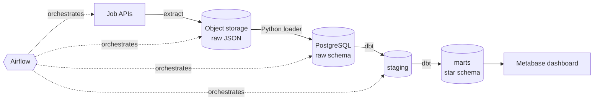
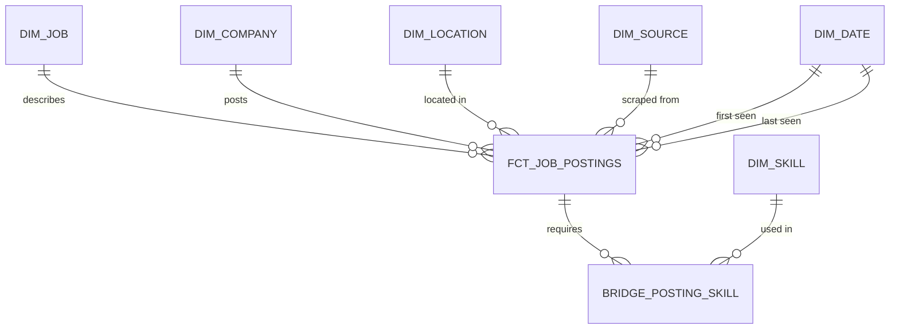

# Job Postings ELT Pipeline

[](https://github.com/AstritJ/job-postings-elt/actions/workflows/ci.yml)

An end-to-end data engineering project: scrape public job postings, land them in object storage,
load them into a PostgreSQL warehouse, and model them into a tested star schema with dbt —
orchestrated by Airflow and fully containerised.

> **Status:** 🚧 In progress — Phase 2 (extract & load) complete. See [Roadmap](#roadmap).

## Architecture



| Layer | Tool | Purpose |
|---|---|---|
| Ingestion | Python + httpx | Collect postings from public job APIs |
| Data lake | SeaweedFS (S3 API) | Immutable raw files, partitioned by date |
| Warehouse | PostgreSQL 17 | `raw` → `staging` → `marts` schemas |
| Transformation | dbt | Modelling, tests, documentation, lineage |
| Orchestration | Airflow | Scheduling, retries, backfills |
| BI | Metabase | Dashboards |

## Data model

Grain of the fact table: **one row per job posting**. Design source: [`docs/schema.dbml`](docs/schema.dbml).



Key design decisions are recorded in [`docs/decisions.md`](docs/decisions.md).

## Quickstart

**Prerequisites:** Docker Desktop, Python 3.12+, Git.

```bash
# 1. Configuration
cp .env.example .env                 # PowerShell: Copy-Item .env.example .env

# 2. Start the platform
docker compose up -d
docker compose ps                    # postgres should show "healthy"

# 3. Python environment
python -m venv .venv
source .venv/bin/activate            # PowerShell: .venv\Scripts\Activate.ps1
pip install -e ".[dev]"
pre-commit install

# 4. Verify everything is wired up
python scripts/check_infra.py
```

### Local services

| Service | URL | Credentials |
|---|---|---|
| PostgreSQL | `localhost:5432` | from `.env` |
| S3 API | http://localhost:8333 | from `.env` |
| Storage browser (Filer UI) | http://localhost:8888 | — |

## Running the pipeline

```bash
python -m job_pipeline run                       # extract + load all sources for today (UTC)
python -m job_pipeline extract --source himalayas --max-pages 2
python -m job_pipeline load --date 2026-10-31    # (re)load a landed day
```

Raw files land in object storage as Hive-style partitions:

```
raw-job-postings/source=arbeitnow/ingest_date=2026-10-31/page-0001.json
                                                         _manifest.json   <- written last = partition complete
```

Both steps are **idempotent**: re-running a source + day overwrites that partition (in storage and
in `raw.job_postings`) instead of duplicating it. This is covered by an integration test.

## Data sources

| Source | API | Pagination | Natural key |
|---|---|---|---|
| [Arbeitnow](https://www.arbeitnow.com) | `api/job-board-api` | page number (`links.next`) | `slug` |
| [Himalayas](https://himalayas.app) | `jobs/api` | cursor (`nextCursor`) | `guid` |

Job data © the respective boards. Many thanks to [Arbeitnow](https://www.arbeitnow.com) and
[Himalayas](https://himalayas.app) for providing free public APIs; every stored job keeps its
original URL for attribution. Requests are capped per run and paced politely.

## Development

```bash
pytest -m "not integration"          # unit tests (no Docker needed)
pytest -m integration                # integration tests (stack must be running)
ruff check . && ruff format .        # lint + format
```

CI (GitHub Actions) runs linting and unit tests on every push — see [`.github/workflows/ci.yml`](.github/workflows/ci.yml).

## Project structure

```
├── airflow/dags/        # Orchestration (Phase 4)
├── data/samples/        # Small real API samples, used as test fixtures
├── dbt/                 # Transformations & tests (Phase 3)
├── docs/                # Schema design + architecture decisions
├── scripts/             # Operational scripts (infra checks, one-off loads)
├── sql/init/            # Warehouse bootstrap SQL (runs on first start)
├── sql/raw/             # DDL for raw landing tables
├── src/job_pipeline/    # Python package: sources, extract, load, CLI
├── tests/
└── docker-compose.yml
```

## Roadmap

- [x] **Phase 0** — Data model design (star schema, grain, SCD strategy)
- [x] **Phase 1** — Local platform: Docker Compose, PostgreSQL, object storage, config, GitHub Actions CI
- [x] **Phase 2** — Extract from APIs → raw files in object storage → idempotent load into `raw`
- [ ] **Phase 3** — dbt staging & marts with tests
- [ ] **Phase 4** — Airflow DAG orchestration
- [ ] **Phase 5** — SCD Type 2 snapshots, dashboard, documentation polish
