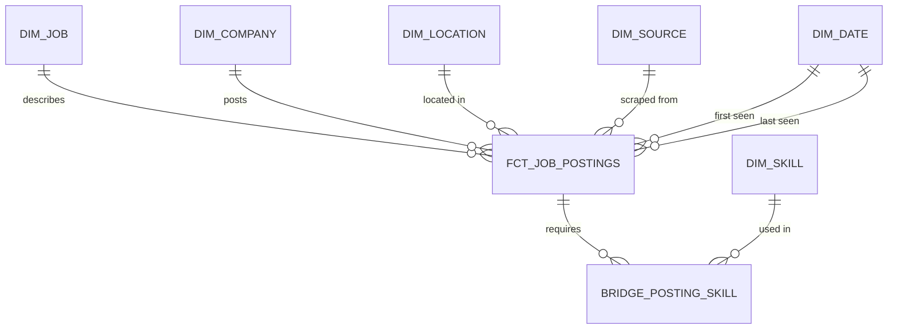

# Job Postings ELT Pipeline

An end-to-end data engineering project: scrape public job postings, land them in object storage,
load them into a PostgreSQL warehouse, and model them into a tested star schema with dbt —
orchestrated by Airflow and fully containerised.

> **Status:** 🚧 In progress — Phase 1 (local platform) complete. See [Roadmap](#roadmap).

## Architecture


| Layer | Tool | Purpose |
|---|---|---|
| Ingestion | Scrapy | Collect postings from public sources |
| Data lake | SeaweedFS (S3 API) | Immutable raw files, partitioned by date |
| Warehouse | PostgreSQL 17 | `raw` → `staging` → `marts` schemas |
| Transformation | dbt | Modelling, tests, documentation, lineage |
| Orchestration | Airflow | Scheduling, retries, backfills |
| BI | Metabase | Dashboards |

## Data model

Grain of the fact table: **one row per job posting**. Design source: [`docs/schema.dbml`](docs/schema.dbml).



Key design decisions are recorded in [`docs/decisions.md`](docs/decisions.md).

## Quickstart

**Prerequisites:** Docker Desktop, Python 3.12+, Git.

```bash
# 1. Configuration
cp .env.example .env                 # PowerShell: Copy-Item .env.example .env

# 2. Start the platform
docker compose up -d
docker compose ps                    # postgres should show "healthy"

# 3. Python environment
python -m venv .venv
source .venv/bin/activate            # PowerShell: .venv\Scripts\Activate.ps1
pip install -e ".[dev]"
pre-commit install

# 4. Verify everything is wired up
python scripts/check_infra.py
```

### Local services

| Service | URL | Credentials |
|---|---|---|
| PostgreSQL | `localhost:5432` | from `.env` |
| S3 API | http://localhost:8333 | from `.env` |
| Storage browser (Filer UI) | http://localhost:8888 | — |

## Development

```bash
pytest -m "not integration"          # unit tests (no Docker needed)
pytest -m integration                # integration tests (stack must be running)
ruff check . && ruff format .        # lint + format
```

CI (GitLab) runs linting and unit tests on every push — see [`.gitlab-ci.yml`](.gitlab-ci.yml).

## Project structure

```
├── airflow/dags/        # Orchestration (Phase 4)
├── dbt/                 # Transformations & tests (Phase 3)
├── docs/                # Schema design + architecture decisions
├── scripts/             # Operational scripts (infra checks, one-off loads)
├── sql/init/            # Warehouse bootstrap SQL (runs on first start)
├── src/job_pipeline/    # Python package: config, clients, scrapers, loaders
├── tests/
└── docker-compose.yml
```

## Roadmap

- [x] **Phase 0** — Data model design (star schema, grain, SCD strategy)
- [x] **Phase 1** — Local platform: Docker Compose, PostgreSQL, object storage, config, CI
- [ ] **Phase 2** — Scraper → raw files in object storage → idempotent load into `raw`
- [ ] **Phase 3** — dbt staging & marts with tests
- [ ] **Phase 4** — Airflow DAG orchestration
- [ ] **Phase 5** — SCD Type 2 snapshots, dashboard, documentation polish
